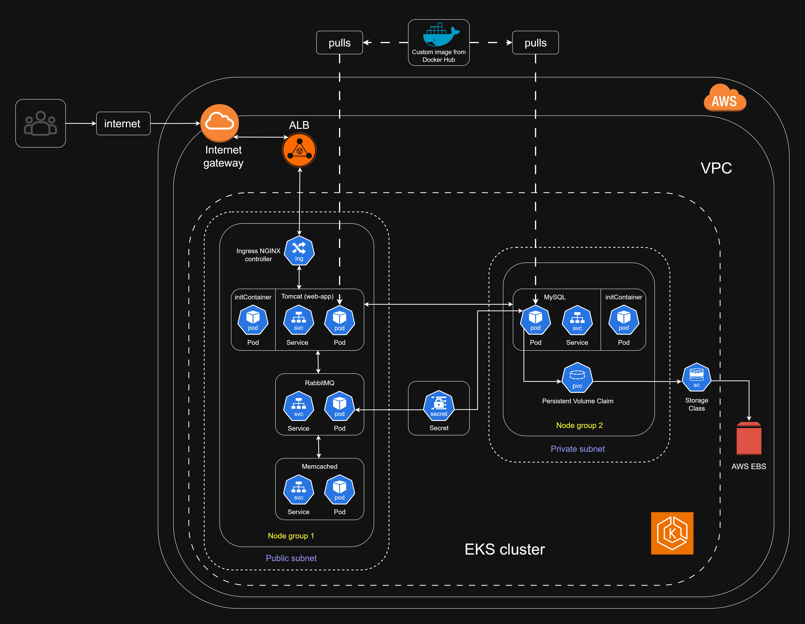

# Project 2: Kubernetes Deployment of Multi-Service Java Application on AWS EKS

[](#)
[](#)
[](#)

---

## About the 4-Project DevOps System

This self-designed, 4-part DevOps portfolio series is intended to demonstrate the staged cloud migration and infrastructure maturity path of a multi-service web application: from containerization, to Kubernetes orchestration, to infrastructure automation, CI/CD, and observability and finally to Gitops-based application delivery.

- **Project 1**: Multi-service containerization and deployment using Docker Compose on AWS EC2 - [Project 1](https://github.com/ravi-rajyaguru15/Project-01-dockerized-multi-service-application)
- **Project 2 (this)**: Kubernetes orchestration of the same application stack on AWS EKS  
- **Project 3**: Infrastructure as Code with Terraform, CI/CD via GitHub Actions, and monitoring using Prometheus and Grafana - [Project 3](https://github.com/ravi-rajyaguru15/Project-03-terraform-cicd-observability-pipeline)
- **Project 4**: GitOps-based application delivery on AWS EKS using GitHub Actions and Argo CD - [Project 4](https://github.com/ravi-rajyaguru15/Project-04-gitops-argocd)

The Java web application used across this portfolio is externally sourced. Minor UI/content adjustments are made to remove source-specific branding and present it as a neutral demo web application. The infrastructure design, containerization, cloud deployment, Kubernetes manifests, Terraform configuration, CI/CD workflow setup, monitoring integration, documentation, troubleshooting, and migration-stage decisions were independently implemented. The same application stack is intentionally reused across all three projects so the focus remains on infrastructure maturity and core DevOps practices.

---

## Project Overview

This project demonstrates the second migration stage: moving the previously containerized multi-service Java web application stack from Docker Compose on AWS EC2 to Kubernetes orchestration on AWS EKS.

The same application stack from Project 1 is represented using Kubernetes resources such as Deployments, Services, Ingress, Secrets, PersistentVolumeClaims, and initContainers. The EKS cluster is provisioned using `eksctl`, with IAM/OIDC and EBS CSI support configured for PVC-backed persistent storage. The application is exposed externally through an NGINX Ingress Controller backed by AWS load balancing.

---

## Project Scope

This stage focuses on Kubernetes orchestration, internal service discovery through Kubernetes Services and cluster DNS, internal service communication, ingress routing, Kubernetes-based runtime configuration, EBS-backed persistent storage, and hands-on troubleshooting inside a managed EKS cluster.

It is not intended to represent a fully production-operated Kubernetes environment. Advanced access control, deeper security hardening, autoscaling, centralized logging, advanced secret management, release strategy, reliability practices, and team-based operational workflows are intentionally outside the scope of this stage and are areas I aim to deepen through professional cloud/platform engineering experience.

---

## Architecture Overview



---

## Tech Stack

- **Infrastructure**: AWS EKS, EKS managed node groups, VPC networking managed through `eksctl`
- **Cluster Provisioning**: `eksctl`
- **Orchestration**: Kubernetes
- **Workloads**: Tomcat web app, MySQL, RabbitMQ, Memcached
- **Routing**: NGINX Ingress Controller, Kubernetes Ingress
- **Storage**: PersistentVolumeClaim, Amazon EBS, EBS CSI Driver
- **Runtime Configuration & Startup Control**: Kubernetes Secrets, initContainers
- **Tooling**: `kubectl`, AWS CLI, Docker Hub

---

## Repository Structure

```text
Project_02/
│      
├── kubernetes/
│   ├── deployments/                               # Pods for app, mysql, rabbitmq, memcached 
│   │   ├── app-deployment.yaml                      and initContainers
│   │   ├── mysql-deployment.yaml
│   │   ├── rabbitmq-deployment.yaml
│   │   └── memcached-deployment.yaml
│   │
│   ├── services/                                  # ClusterIP services      
│   │   ├── web-app-service.yaml
│   │   ├── mysql-service.yaml
│   │   ├── rabbitmq-service.yaml
│   │   └── memcached-service.yaml
│   │
│   ├── ingress/                                   # NGINX ingress resource
│   │   └── nginx-ingress.yaml
│   │
│   ├── secrets/                                   # Base64 encoded secrets containing MySQL 
│   │   └── secrets.yaml                             and RabbitMQ credentials
│   │
│   └── persistentVolumeClaim/                     # MySQL PVC
│       └── mysql-pvc.yaml
│      
├── images/
|   ├── screenshots/...                            
│   └── architecture/
|         └── project-2-architecture.png 
│      
├── legacy/                                        # Files and artifacts carried over from project 1  
│   ├── app/...                                      for continuity purposes, but are not an active  
│   ├── mysql/...                                    part of project 2.
│   ├── nginx/...
│   ├── images/...                         
│   ├── .env                                                                           
│   └── docker-compose.yml  
│                                 
├── project2-eksctl-config.yaml                    # Cluster definition configuration file for eksctl     
└── README.md                                      # Project README
```
---

## How to Deploy (Reproduction Steps)

1.  **Prerequisites/Dependencies**:
      - Local machine with `aws-cli`, `eksctl`, `kubectl`, and `git` installed
      - AWS account configured via AWS CLI, and with appropriate IAM permissions.
2. Open a bash terminal and fetch the project files via git clone, and navigate into the project folder.
3. Create EKS cluster:
    ```bash
    eksctl create cluster -f project2-eksctl-config.yaml
    ```
4. Connect to the cluster and get node information:
    ```bash
    aws eks update-kubeconfig --region us-east-1 --name project2-eks-cluster
    ```
    ```bash
    kubectl get nodes
    ```
5. Install NGINX Ingress Controller and verify its pods and services:
    ```bash
    kubectl apply -f https://raw.githubusercontent.com/kubernetes/ingress-nginx/controller-v1.10.1/deploy/static/provider/aws/deploy.yaml
    ```
    ```bash
    kubectl get pods -n ingress-nginx
    kubectl get svc -n ingress-nginx
    ```
6. Apply Kubernetes manifests:
    ```bash
    kubectl apply -f kubernetes/secrets/
    kubectl apply -f kubernetes/persistentVolumeClaim/
    kubectl apply -f kubernetes/deployments/
    kubectl apply -f kubernetes/services/
    kubectl apply -f kubernetes/ingress/
    ```
7. Verify Deployment:
    ```bash
   kubectl get pods
   kubectl get pvc
   kubectl get all
    ```
8. Access the web application using the external DNS endpoint from the NGINX Ingress Controller service: 
    ```bash
    # Locate EXTERNAL-IP of ingress-nginx service
    
    kubectl get svc -n ingress-nginx
    ```
9. After verification, remove the ingress resources before destroying the AWS infrastructure:

    ```bash
    kubectl delete -f https://raw.githubusercontent.com/kubernetes/ingress-nginx/controller-v1.10.1/deploy/static/provider/aws/deploy.yaml
    ```

10. Thenafter terminate and clean the EKS cluster and VPC to avoid incurring unnecessary AWS costs:
    ```bash
    eksctl delete cluster --name project2-eks-cluster --region us-east-1
    ```
    ```bash
    # If cluster deletion gets stuck during node group eviction, the following force cleanup command can be used:
    
    eksctl delete cluster \
    --name project2-eks-cluster \
    --region us-east-1 \
    --disable-nodegroup-eviction \
    --force
    ```   
---

## Engineering Insights

- Built Kubernetes resources using raw YAML manifests without Helm or third-party abstractions, which helped maintain visibility into Deployments, Services, Ingress, Secrets, and PVC behavior.
- Configured IAM/OIDC and EBS CSI support through `eksctl` to enable PVC-backed persistent storage on EKS, after initially troubleshooting manual PVC binding and storage provisioning issues.
- Used initContainers in MySQL to handle EBS-mounted filesystem behavior before database startup.
- Used initContainers in the web application deployment to delay startup until dependent service DNS names were resolvable inside the cluster.
- Built, tagged, and published custom Docker Hub images for the web app and database to support reproducible deployments.
- Debugged deployment issues including CrashLoopBackOff events, PVC mount failures, IAM permission errors, service discovery issues, and image pull behavior.

---